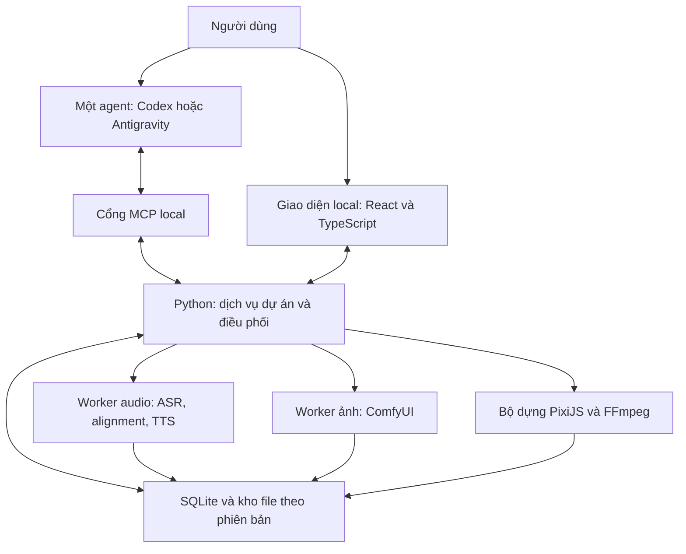

# Kế hoạch xây Story Motion Studio Local

Phiên bản 1.0 — 14/10/2026 — Đặc tả triển khai đề xuất.

## 1. Kết quả sản phẩm

Một ứng dụng chạy trên Windows, nhận SRT và audio, để một agent bên ngoài lập kế hoạch biên tập rồi gọi công cụ local tạo tài nguyên, dựng chuyển động, ghép âm thanh và xuất MP4. Người dùng theo dõi/chỉnh sửa qua giao diện tiếng Việt. Sản phẩm cuối gồm video, phụ đề, dự án tiếp tục chỉnh sửa được và thông tin nguồn tài nguyên.

Đây là studio nhiều dự án, có thư viện dùng chung và bộ nhớ biên tập giữa các video. Không phải web demo, công cụ slideshow chỉ zoom ảnh, dịch vụ cloud render hoặc ứng dụng phải mua API LLM riêng.

### Các ranh giới bắt buộc

1. Một agent tại một thời điểm; không yêu cầu hai agent, subagent hay model phản biện riêng.
2. Công việc sáng tạo cần agent kết nối. Khi chưa có agent, studio vẫn cho nhập/chỉnh/render kế hoạch hiện có; không giả có “AI nội bộ” tự nghĩ kịch bản.
3. Suy luận của Codex/Antigravity thuộc gói người dùng đang dùng và thường cần kết nối dịch vụ đó. “Local” áp dụng cho media workers, model bổ trợ, dữ liệu và render; không hứa toàn bộ hệ thống hoạt động offline.
4. Không mua/khởi tạo API AI hoặc dịch vụ trả phí bổ sung. Không tự thêm image/video cloud hay TTS cloud.
5. Không tự đăng YouTube, không tự viết lại lời gốc, không tự thay nhân vật/phong cách đã khóa.
6. Không gọi model cho từng khung hình; chuyển động được tính bằng bộ dựng.

## 2. Cơ sở và những gì chưa biết

Phần cứng đã xác nhận: i5-12400F, RAM 16 GB, RTX 3050 6 GB VRAM, SSD. Ảnh Task Manager từng cho thấy RAM dùng trên 90%; đó là ảnh chụp một thời điểm, không phải benchmark hay dung lượng luôn còn trống.

Các phần đã quan sát ở video tham chiếu gồm nền sạch, nhân vật nét viền, tư liệu, chữ/biểu tượng, thay tư thế và xuất hiện chi tiết theo nhịp lời. Bản video hiện đọc được kết thúc sớm khoảng 13:50 so với metadata 21:11; có một số ảnh trích muộn từ lần trước, nhưng không có kiểm chứng liên tục toàn bộ video cùng âm thanh. Không suy ra phần mềm gốc, rig hay lip-sync từ kết quả hình ảnh. Chưa có bộ SRT/audio sản xuất thực tế của người dùng.

Không để thiếu các dữ liệu này chặn việc xây nền tảng. Dùng fixture nhỏ có ghi rõ là dữ liệu minh họa, không ngụy tạo rằng đã tái tạo thành công video mẫu.

## 3. Kiến trúc được chọn

### Các quyết định kỹ thuật

| Thành phần | Lựa chọn | Trách nhiệm / giới hạn |
|---|---|---|
| Giao diện | React + TypeScript + Vite | Chạy ở localhost; quản lý dự án, storyboard, timeline, tài nguyên, tiến độ. Không bắt buộc Electron/Tauri ở bản đầu. |
| Dịch vụ | Python + FastAPI + Pydantic | Một nguồn xử lý nghiệp vụ chung cho UI và MCP; kiểm tra dữ liệu và phiên bản. |
| Cổng agent | Python MCP SDK, transport STDIO trước | Bridge mỏng tới dịch vụ đã chạy. Không spawn lại media worker mỗi lần agent kết nối. Có thể bổ sung Streamable HTTP sau, không cần cho bản đầu. |
| Dữ liệu | SQLite giao dịch + file theo hash + manifest JSON | DB quản lý revision/job/metadata; manifest là snapshot được tạo qua service. Không để hai nơi cùng là nguồn chỉnh sửa độc lập. |
| Lịch việc | Hàng đợi trong dịch vụ, worker subprocess | Một GPU-heavy job mỗi lần; không dùng Redis/Celery/Docker làm điều kiện bắt buộc. |
| Dựng hình | PixiJS 8 + TypeScript scene evaluator | Cùng hàm đánh giá trạng thái theo thời gian cho preview và export; scene graph, layer, mask, chữ, camera, pose. |
| Export hình | Chromium local do Playwright điều khiển | Dừng ticker realtime, đặt frame cụ thể, đợi font/texture sẵn, xuất canvas theo frame. Không dùng MediaRecorder hoặc chụp playback realtime. |
| Video/audio | FFmpeg + ffprobe | Encode/mux, chuyển audio, mix, thông tin file. H.264 NVENC ưu tiên nếu có; CPU fallback được báo rõ. |
| Môi trường | Env riêng cho core, ASR, TTS, ComfyUI | Tránh torch/CUDA của các worker xung đột. Khóa phiên bản tương thích sau khi xác minh trên máy. |

PixiJS là nền dựng 2D, không có sẵn toàn bộ chức năng editor/rig/timeline của sản phẩm. Những chức năng đó phải được xây, không được mô tả như đã có chỉ vì cài thư viện.

### Cách khởi chạy

Một launcher Windows mở core và UI; worker nặng khởi động khi cần. Có công cụ chẩn đoán Python/Node, FFmpeg, driver/CUDA, NVENC, font tiếng Việt, RAM/VRAM/dung lượng đĩa và đường dẫn Unicode. Chẩn đoán cần dùng đúng máy người dùng; không lấy GPU của môi trường cloud làm cấu hình máy họ.

Bind localhost; bridge dùng token/session local, allowlist thư mục dự án và kiểm tra đường dẫn. Không mở port ra internet. Ghi rõ cách cấp quyền agent đọc/ghi workspace; không sửa quyền hoặc cấu hình bảo mật ngầm.

## 4. Model local và phương án tài nguyên

| Tác vụ | Lựa chọn khởi đầu | Phương án khi không phù hợp |
|---|---|---|
| Nhận dạng tiếng Việt | faster-whisper, model multilingual `medium`, `int8_float16`, batch nhỏ | `small` multilingual ở profile tiết kiệm, hoặc CPU INT8. Phải báo khác biệt profile; chưa hứa độ chính xác/tốc độ. |
| Căn từ | WhisperX alignment với model tiếng Việt tương thích | Căn theo câu + mốc chỉnh tay nếu từ không căn được; không tạo word timestamps giả. Kiểm tra artifact/model card thực tế khi cài. |
| Khoảng có giọng | VAD của pipeline audio | Chỉ gợi ý khoảng nghỉ; không coi mọi im lặng là lỗi hoặc tự cắt. |
| TTS | VieNeu-TTS v3 Turbo local, ưu tiên CPU ONNX để nhường GPU | GPU backend khi cần và có cấu hình tương thích; giữ audio gốc nếu giọng thay không phù hợp. Không chuyển sang API trả phí. |
| Hình đơn giản | ComfyUI + profile SD 1.5 local nhẹ | Dùng vector/layer hoặc ảnh có sẵn cho bố cục cần chính xác; SD 1.5 không được xem là đủ chất lượng cho mọi cảnh. |
| Hình phức tạp hơn | Profile SDXL base tùy chọn, batch 1, offload khi cần | Chỉ bật nếu có đủ RAM/VRAM và kết quả phù hợp; không hứa chạy tốt trên 6 GB. Nếu không đủ, giữ task blocked hoặc chọn cách minh họa khác minh bạch. |
| Nhân vật nhất quán | Bộ nhân vật gốc SVG/PNG tách lớp, pose và biểu cảm đã khóa | Tư thế mới là yêu cầu tài nguyên có cấu trúc; không sinh lại toàn bộ nhân vật ở mọi cảnh. |

Không cài cả faster-whisper độc lập và WhisperX rồi nhận dạng cùng một audio hai lần. Adapter tái sử dụng transcript/audio analysis; gọi alignment riêng khi cần. Đối với một giọng đọc, diarization không phải thành phần bắt buộc.

Các profile ảnh phải lưu checkpoint cụ thể, hash, nguồn, license, workflow và cấu hình. SD 1.5/SDXL là hướng khởi đầu đã có nguồn công khai, không phải tuyên bố đạt chất lượng video mẫu. Không tự tải nhiều checkpoint/LoRA/ControlNet để “thử vận may”. Bổ sung tối đa thành phần điều khiển cần thiết cho một tác vụ rõ ràng và lưu tương thích. Trước tải model, hiển thị tổng dung lượng và sử dụng cơ chế cấp phép cài đặt bình thường của môi trường; không hỏi lặp lại nếu đã được cho phép.

Code, weights, tokenizer, preset voice và tài nguyên có thể có giấy phép riêng. VieNeu-TTS v3 Turbo model card hiện ghi Apache-2.0 và cho phép dùng preset voices/audio trong nội dung thương mại; pin đúng artifact đã kiểm tra. SD 1.5 và SDXL có giấy phép OpenRAIL với điều kiện sử dụng, không ghi chung là “không điều kiện”. Tài nguyên web mặc định tắt tự tìm/tải; người dùng có thể bật cho dự án.

## 5. Luồng sản xuất chuẩn

### 5.1 Nhập và bảo toàn

Copy hoặc đăng ký file gốc có hash; không sửa trực tiếp nguồn. Kiểm tra SRT Unicode, định dạng thời gian, audio đọc được, thời lượng, sample rate/channels. Tạo working audio PCM 48 kHz nếu cần, giữ gain/tốc độ mặc định. SRT không phải nguồn sự thật về thời gian hoặc lời nếu có mâu thuẫn với audio.

### 5.2 Chuẩn bị audio một lần

Nhận dạng, đối chiếu câu/từ, báo đoạn đáng nghi kèm vị trí. Không tự sửa tên theo ASR. Nếu cần chỉnh khoảng nghỉ, amplitude hoặc TTS: thao tác trên bản mới, cập nhật time map, giữ undo. Mặc định không tự cắt pause, thay lời hay TTS. Khóa revision audio dùng cho timeline sau khi các chỉnh sửa được quyết định. Agent không được kết luận đã nghe nếu chỉ có transcript.

### 5.3 Biên tập trước khi tạo

Agent đọc tổng thể nội dung và profile kênh; xem tóm tắt các video liên quan, không mở lại cả thư viện media. Tạo một hướng dựng chính, có lý do. Với video dài, có thể ghi kế hoạch theo chương dưới cùng một outline đã khóa; không yêu cầu một lần gọi model chứa toàn bộ JSON khổng lồ.

Chốt: mạch kể, câu hỏi trung tâm, mức chắc chắn của dữ kiện, nhịp cảm xúc, chủ thể, cách giải thích ý khó, vai trò của từng hình, hành động, mốc lời, nhạc/SFX. Bản kế hoạch thiếu tài nguyên/hành động không được chuyển sang sinh hàng loạt.

### 5.4 Kiểm tra điều kiện local

Kiểm tra schema, revision, references, font, khả năng công cụ, rig/pose, nguồn dữ kiện cần chính xác, thời lượng, mốc từ, ngân sách công việc và bộ nhớ ước lượng. Đây là preflight kỹ thuật, không xác nhận mọi quyết định biên tập đều đúng. Lỗi trả về theo ID và vị trí để agent sửa một patch, không gửi lại toàn bộ dự án.

### 5.5 Chuẩn bị tài nguyên

Thứ tự: tìm tài nguyên đã khóa → dựng SVG/chữ/đồ họa từ dữ liệu → tạo ảnh local chỉ phần còn thiếu. Bộ ảnh mỗi cảnh không phải một ảnh toàn màn hình duy nhất nếu cần các bộ phận hoạt động riêng. Lưu tài nguyên ngay sau thành công; không mặc định gọi AI đánh giá hoặc sinh lại.

### 5.6 Dựng và xuất

Biên dịch plan thành timeline thực thi; dựng theo frame, không gọi LLM. Tác vụ render đóng băng revision và hash đầu vào. Giữ audio master toàn bài; chunk video theo khoảng frame có thể tái sử dụng, ghép chuẩn và mux audio một lần. Preflight và kiểm tra kỹ thuật đầu ra không cần model. Người dùng có thể mở video/xem cảnh bất kỳ; việc xem không tự khởi động vòng AI sửa.

### 5.7 Ghi nhớ cho video tiếp theo

Lưu tóm tắt nội dung, cấu trúc, nhịp, bố cục/chuyển động nổi bật, tài nguyên, mẫu người dùng thích và phạm vi sở thích. Không tự coi số lượt xem là thước đo trực tiếp cho chất lượng dựng.

## 6. Biên tập nhiều video, không một màu

Ba lớp riêng: nhận diện kênh; hướng biên tập mỗi tập; biểu đạt từng cảnh. Giữ nét vẽ/nhân vật khi phù hợp, thay cách kể theo chủ đề. Các hướng có thể kết hợp: theo dòng thời gian, điều tra manh mối, giải thích cơ chế, so sánh bằng chứng, câu chuyện một nhân vật, hành trình giải quyết vấn đề. Không ép tất cả vào danh sách template cố định.

Hồ sơ episode chứa `narrative_approach`, `tone`, `opening_promise`, `payoff`, `visual_balance`, `pacing_notes`, `distinctive_choices`. Đối chiếu lịch sử bằng metadata và tìm kiếm local; agent chỉ nhận một số tóm tắt liên quan. Không dùng thêm model embedding/LLM chỉ để chống lặp ở bản đầu.

Mỗi scene brief phải nói rõ: người xem đang biết gì; cần hiểu thêm gì; điều nào chưa được tiết lộ; cảm xúc dự định; điểm nhìn chính; vai trò hình; diễn xuất; sự kiện theo lời; cách nối. “Ảnh đúng từ khóa” không đủ mô tả một cảnh.

Không quy định cứ 3 giây cắt cảnh, không bắt mọi câu có hiệu ứng, không lấy số ảnh/phút làm chất lượng. Tĩnh có chủ ý được chấp nhận. Một nhân vật có thể nhìn, chuẩn bị hành động, thực hiện rồi phản ứng; các nhịp phải nằm trong audio, không tự kéo audio để khớp một hoạt hình tùy hứng.

## 7. Prompt ảnh và cấu trúc nhân vật

Mỗi asset request trước sinh gồm:

- Vai trò kể chuyện và các scene dùng nó; ảnh tài liệu hay minh họa.
- Nhân vật/style revision, reference IDs, bố cục, góc nhìn, tỷ lệ và nền.
- Thành phần bắt buộc, chi tiết phải giữ, chi tiết cấm tự thêm.
- Tư thế, biểu cảm, quan hệ tay–đạo cụ, phần cần thấy/che.
- Output: kích thước, định dạng, alpha thực hay nền cần xử lý; các lớp cần có.
- Prompt tiếng Anh nếu phù hợp checkpoint; bản diễn giải tiếng Việt để người dùng hiểu. Lưu positive/negative nếu workflow hỗ trợ.
- Workflow ID, model hash, seed, sampler/steps/strength và tham số được profile cho phép.
- Quy tắc tái sử dụng, cache key và định nghĩa đã thực hiện đúng yêu cầu kỹ thuật.

Không tuyên bố seed cố định đảm bảo nhân vật giống nhau hoặc ảnh giống tuyệt đối giữa phần cứng/phiên bản. Không giả rằng model ảnh tự trả PSD tách lớp, alpha hay cấu trúc rig. Nếu workflow không xuất alpha/layer thì yêu cầu này chưa được đáp ứng.

Nhân vật gốc dùng nét viền 2D có biểu cảm, không mặc định người que sơ sài. Bộ cơ bản: trung tính, trình bày, chỉ trái/phải, suy nghĩ, tò mò, ngạc nhiên, nghi ngờ, cầm vật. Dùng các bộ phận có điểm xoay, pose swap và bộ biểu cảm; scene có thể tạo pose mới theo hồ sơ. Tạo SVG theo cấu trúc là hướng hợp lệ cho chi tiết chính xác và nhân vật tái sử dụng, không bắt mọi thứ phải qua diffusion.

Chưa bắt buộc lip-sync, sinh video diffusion, hoạt hình 3D, train LoRA hoặc model thị giác local tự chấm ảnh. Đây là mở rộng, không được dùng để kéo dài nền tảng trước khi đường sản xuất cơ bản hoạt động.

## 8. Đồng bộ lời–hình và render

Audio cuối là đồng hồ chính. Timeline dùng mốc sample nguyên; FPS lưu dưới dạng phân số. Mặc định 48,000 samples/giây, 30/1 fps: một frame là 1,600 samples. Mỗi sự kiện bám `word_id`/`utterance_id` hoặc mốc thủ công có bằng chứng, cộng offset chủ đích; không tìm từ theo chuỗi không định danh vì từ có thể lặp lại.

Chuỗi: audio revision → transcript/alignment → anchors → plan revision → render spans. Thay audio làm các downstream object tương ứng stale; không xóa tài nguyên còn dùng được. Thay thời lượng cần cập nhật cả khoảng phía sau và mốc nối; thay nghĩa phải rà scene liên quan, không chỉ dịch keyframe.

Preview lấy thời gian audio làm chuẩn. Export đánh giá `frame_index` trên clock cố định, chờ tài nguyên sẵn và render từng frame; không dùng tốc độ máy làm thời gian. Chỉ tắt loop preview trong quá trình export; không cần phát video theo thời gian thật.

Render span là khoảng frame nửa mở `[start, end)`, phủ liên tục, không trùng. Chuyển cảnh cần dữ liệu hai phía nằm trong dependencies của span và chỉ xuất đúng số frame; không chèn thêm thời lượng khi ghép. Encode span với thông số tương thích; concatenate video copy khi điều kiện codec/timebase phù hợp. Nếu buộc encode lại phải ghi rõ, không ngầm degrade. Audio mix toàn bài một lần để tránh cắt giọng tại ranh cảnh. Dùng khung hình cuối/padding có chủ ý cho phần lẻ dưới một frame; không đổi tốc độ audio.

Xuất MP4 H.264, 1080p30, pixel format tương thích phổ thông, audio AAC 48 kHz; SRT UTF-8 riêng. Burn-in phụ đề là tùy chọn tách khỏi chữ nhấn. NVENC tăng tốc encode, không bảo đảm toàn pipeline GPU. Font local tiếng Việt và màu SDR sRGB/Rec.709 xử lý nhất quán; kiểm tra mapping và alpha trước encode.

Không ghi toàn bộ hàng chục nghìn PNG xuống SSD mặc định. Ưu tiên frame buffer bounded/pipe; nếu cần spool để ổn định, chỉ một span và dọn sau encode thành công. Clip tư liệu được decode theo timestamp của nó, không dựa vào playback realtime; nếu chưa hỗ trợ tốt VFR, tạo proxy CFR có mapping trước khi dùng.

## 9. Tiết kiệm token, tránh làm lại

| Quy tắc | Hành vi mặc định |
|---|---|
| Kế hoạch | Outline toàn bài, sau đó brief/prompt theo nhóm cảnh khi cần; không tự tạo nhiều phương án |
| Thông tin agent nhận | Summary + changes + issues; chi tiết lấy theo ID |
| Dữ liệu nhị phân | Không đưa base64 ảnh/audio vào tool response mặc định |
| Kiểm tra định kỳ | Không gọi agent theo timer hoặc mỗi frame/cảnh |
| Sinh tài nguyên | Một request cho phần còn thiếu; 0 tự sinh lại vì thẩm mỹ |
| Retry hạ tầng | Tối đa một lần với lỗi transient xác định an toàn; xác minh job đã có kết quả trước khi gửi lại |
| OOM | Dừng worker nặng, giữ kết quả; profile giảm tải chỉ khi đã cho phép, không retry mù |
| Sửa | Patch đúng object; invalidate phụ thuộc, không dựng lại toàn bộ |
| Đánh giá AI | Chỉ khi có lỗi/nghi vấn cụ thể hoặc người dùng yêu cầu |
| Hạn mức | Không tự chuyển provider, mua credits hoặc gọi API trả phí |

Số token của agent không phải lúc nào studio đọc được chính xác. Ghi tool calls, kích thước payload, job attempts và số lần sinh; không hiển thị số token/tiền tiết kiệm giả. Local generation tốn tài nguyên/thời gian nhưng không phải token thanh toán API bổ sung.

## 10. Tài nguyên máy, cache và an toàn dữ liệu

Một GPU-heavy worker hoạt động mỗi lần; release/offload/đóng process theo khả năng worker trước khi đổi tác vụ. Renderer cũng tính vào lịch tài nguyên khi cần VRAM đáng kể. TTS CPU là lựa chọn khởi đầu, không phải mọi tác vụ phải ép lên GPU.

Không tải model nếu thiếu RAM/VRAM theo profile ước lượng; dùng đo thực tế sau lượt chạy nhỏ. Dung lượng dự trữ và ngưỡng được cấu hình, không giả biết SSD còn trống bao nhiêu. Preview 720p; tài nguyên ảnh chỉ tạo ở kích thước có lý do, không mặc định 4K. Không tự hạ resolution bản cuối.

Cache dùng hash nội dung và revision phụ thuộc. Dọn cache tạm theo LRU chỉ với file có thể tái tạo, không có job đang đọc và không được pin. Không xóa source, final, rig, references hay model người dùng cài ngoài studio. Có xuất backup dự án bao gồm manifest, asset provenance và asset cần thiết; model lớn tham chiếu bằng manifest, không buộc chép vào mọi dự án.

Một dịch vụ sở hữu trạng thái DB. Agent lease + optimistic revision ngăn agent/UI ghi đè. Chuyển agent cần giải phóng/thu hồi lease có trạng thái; không yêu cầu hai agent chạy cùng lúc. Lệnh lặp có idempotency key. Job có checkpoint, cancel, timeout và recover orphaned process; child process hoàn tất vẫn có thể được ghi nhận khi agent đã ngắt.

## 11. Giao diện cần có

1. Danh sách dự án và hàng đợi: nguồn, tiến độ, phiên bản, tác vụ đang chờ.
2. Audio/SRT: waveform, câu/từ và điểm chưa khớp; bản gốc cạnh bản làm việc.
3. Biên tập: outline, bảng cảnh, ý định cảm xúc, prompt và trạng thái đã chốt.
4. Thư viện: nhân vật, pose, đạo cụ, tư liệu, nhạc; provenance, tìm kiếm, nơi đang dùng.
5. Timeline/preview: layer, keyframe, audio anchors, camera, chữ; thay asset/pose, undo/redo.
6. Tiến độ và ngoại lệ: hiển thị nguyên nhân và phần bị ảnh hưởng; không spam log/confirmation.
7. Xuất và cài đặt: profile render, model local, bộ nhớ, kết nối agent, quyền sửa lời và nguồn web.

Ngôn ngữ UI gần công việc của người dùng; model hash, CUDA và JSON nằm ở phần nâng cao. Không yêu cầu người dùng viết JSON để dựng video. Nếu chưa có agent, hiển thị “Cần agent lập kế hoạch” và cung cấp context/brief; nút “AI làm video” không được giả hoạt động bằng một template cứng.

## 12. Trạng thái chất lượng và giới hạn

Phân biệt rõ: kế hoạch đủ điều kiện; tài nguyên đã tạo; render thành công; kỹ thuật đầu ra đạt; người dùng đã xem. Không gắn “nội dung chính xác tuyệt đối” hoặc “đã duyệt thẩm mỹ” khi không có căn cứ. Lỗi xác định cốt lõi chặn trạng thái sẵn sàng đăng, vẫn cho xuất nháp ghi rõ. Không dùng tổng điểm thẩm mỹ để bù lỗi dữ kiện.

Tiêu chí đồng bộ kỹ thuật và test phát triển nằm ở `04`. Chỉ giữ những kiểm chứng cần thiết cho rủi ro nền tảng. Chất lượng nhân vật và hành động được thể hiện bằng một đoạn tích hợp có chủ đích lúc xây; không hứa video nào cũng đạt mẫu từ lần đầu hoặc cố chạy nhiều vòng để chứng minh điều không đo được.

## 13. Nguồn chính thức đã đối chiếu

Tra cứu ngày 14/10/2026. Các lựa chọn kiến trúc và profile là đề xuất của tài liệu, không phải chứng nhận khả năng chạy trên máy người dùng.

- Codex MCP, local STDIO/HTTP: https://learn.chatgpt.com/docs/extend/mcp?surface=cli
- Antigravity MCP: https://antigravity.google/docs/mcp
- MCP server: https://modelcontextprotocol.io/docs/develop/build-server
- faster-whisper: https://github.com/SYSTRAN/faster-whisper
- WhisperX: https://github.com/m-bain/whisperX
- VieNeu-TTS code: https://github.com/pnnbao97/VieNeu-TTS
- VieNeu v3 Turbo model/voice rights: https://huggingface.co/pnnbao-ump/VieNeu-TTS-v3-Turbo
- ComfyUI API: https://docs.comfy.org/development/comfyui-server/comms_routes
- SD 1.5 model card, limitations/license: https://huggingface.co/stable-diffusion-v1-5/stable-diffusion-v1-5
- SDXL base model card/license: https://huggingface.co/stabilityai/stable-diffusion-xl-base-1.0
- PixiJS renderers: https://pixijs.com/8.x/guides/components/renderers
- PixiJS scene graph: https://pixijs.com/8.x/guides/concepts/scene-graph
- FFmpeg NVIDIA acceleration: https://docs.nvidia.com/video-technologies/video-codec-sdk/13.1/ffmpeg-with-nvidia-gpu/index.html
- GPU encode matrix: https://developer.nvidia.com/video-encode-decode-support-matrix

## 14. Quyết định còn phụ thuộc lúc triển khai

| Điểm chưa đo | Mặc định để tiếp tục | Khi nào thay |
|---|---|---|
| Driver, phiên bản tương thích | Env worker độc lập, pin sau doctor | Nếu cài không tương thích; không sửa driver toàn máy âm thầm |
| Dung lượng SSD còn trống | Chọn thư mục local và kiểm tra dung lượng trước tải/render | Cho người dùng chọn ổ khác khi cần |
| Model ảnh đạt gu và vừa VRAM | Vector/asset reuse trước; một profile nhẹ và một profile chất lượng tùy chọn | Chỉ đổi dựa trên yêu cầu hình và đo bộ nhớ; ghi quyết định |
| Giọng đọc cần sửa | Preserve mặc định, TTS có công cụ nhưng tắt tự sửa | Theo quyền cấp cho dự án hoặc yêu cầu cụ thể |
| Nguồn tư liệu bên ngoài | Tự tìm/tải tắt; nhập file và nguồn thủ công vẫn hoạt động | Người dùng bật tùy chọn |
| Gu nghệ thuật chi tiết | Tạo bộ nhân vật gốc riêng, bám ngôn ngữ hình của mẫu ở mức đã quan sát | Phản hồi cụ thể về đoạn tích hợp, không chạy A/B hàng loạt |

Những điểm này không phải lý do dừng viết code nền tảng hoặc hỏi lại toàn bộ yêu cầu đã có.
